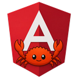

# rangular docs

  

Start at the [guide](README.md) for a friendly overview and installation
(`rangular` + `rangular-build` from crates.io, or git before publication).
This folder holds the contract, release process, and contributor habits.

| Doc | What it is |
| --- | --- |
| [`SPEC.md`](SPEC.md) | Language contract for **0.1.x** (what is in / out of scope) |
| [`CONTRIBUTING.md`](CONTRIBUTING.md) | Fixtures, diagnostics, PR habits |
| [`CHANGELOG.md`](CHANGELOG.md) | Release notes |
| [`RELEASING.md`](RELEASING.md) | Versioning and crates.io publication order |

## Scope in one glance

- **In:** web DOM via Leptos: browser CSR / wasm, native SSR, and SSR with
  browser hydration (all three exercised by tests); external `.html` +
  `.scss`; AOT by default; runtime for tests.
- **Out (v0.1):** full Angular; i18n / NgModule / DI; **native desktop GUI
  toolkits**.

A [Tauri](https://v2.tauri.app/) (or similar) **webview** still counts as the
browser path: you ship the same wasm UI inside a desktop shell. That is not a
separate **[rangular](https://github.com/Interchouette-ITC/rangular)** backend.

## Related projects

External references (not dependencies):

- [Angust](https://github.com/TudorOrban/Angust) - proposed Angular-style Rust
  GUI on native / desktop widgets (outside a webview)
- [Angular Rust](https://github.com/angular-rust) - Angular-inspired Rust UX
  ecosystem

**[rangular](https://github.com/Interchouette-ITC/rangular)** stays on Leptos
and the web DOM (CSR, SSR, hydration). For a desktop window, put that same UI
in a [Tauri](https://v2.tauri.app/) (or similar) webview; see the
[guide](README.md#shipping-a-desktop-app-with-rangular).
