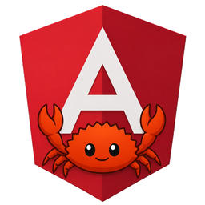
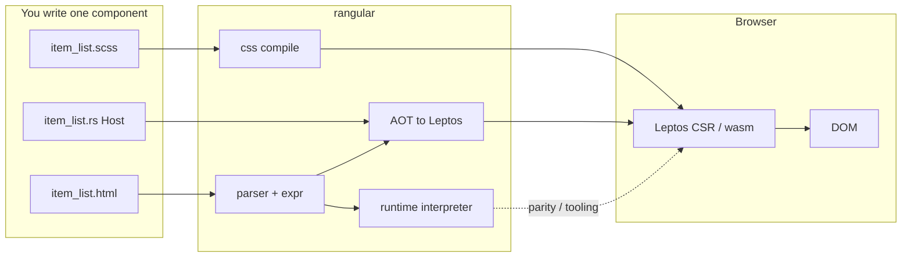
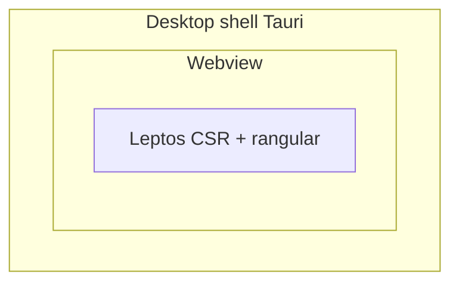
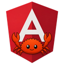

# rangular

<p align="center">
  
</p>

<p align="center">
  <strong>Angular-shaped templates. Rust controllers. Browser DOM.</strong>
</p>

<p align="center">
  <a href="https://github.com/Interchouette-ITC/rangular/actions/workflows/ci.yml"></a>
  <a href="https://codecov.io/gh/Interchouette-ITC/rangular"></a>
</p>

Write markup in familiar `.html` / `.scss`, keep state and handlers in Rust, and
render with [Leptos](https://leptos.dev/): in the browser (CSR / Trunk / wasm),
on the server (SSR), or server-rendered and hydrated in the browser.

**Live:** [https://rangular.interchouette.net](https://rangular.interchouette.net)

Pre-built desktop demos: **[GitHub Releases](https://github.com/Interchouette-ITC/rangular/releases)** (Linux `.deb` / AppImage, Windows NSIS). macOS not in v1.

If you know Angular component files, you will feel at home. If you know Rust,
you keep ownership of the real logic. **[rangular](https://github.com/Interchouette-ITC/rangular)**
sits between the two: a **versioned subset**, not a full Angular port, with
diagnostics (`RANG*`) instead of panics on bad template text.

Production builds use **AOT** lowering to Leptos. A **runtime** interpreter
shares the same AST for parity tests and tooling.

## What you get today

Author **components** as Angular-shaped files; **[rangular](https://github.com/Interchouette-ITC/rangular)**
turns them into Leptos views for the browser. Production prefers **AOT**; the
**runtime** keeps the same AST for tests and tooling.



| Piece                | Role today                                                                      |
| -------------------- | ------------------------------------------------------------------------------- |
| Language             | v0.1 contract in [`SPEC.md`](SPEC.md)                                 |
| Parser / expr / host | Core subset                                                                     |
| Public entry point   | `rangular` facade (`rangular::{aot, css, expr, host, macros, parser, runtime}`) |
| Build support        | `rangular-build` (separate build dependency for `build.rs`)                     |
| AOT                  | `rangular::aot` + `rangular::macros`                                            |
| Runtime              | `rangular::runtime` (parity / tooling)                                          |
| SCSS                 | `rangular::css` (`compile_scss` or encapsulate; Bootstrap utilities stay global) |
| Registry             | Component tags + typed `provide` / `inject`                                     |
| Growth               | Fixture corpus in [`tests/fixtures/`](../tests/fixtures/) (tests; not the demo) |
| Demo                 | [`demo-leptos/`](../demo-leptos/) dogfoods AOT with its own panels                           |

Layers: `tests/fixtures/` is the language growth corpus for crate tests; `demo-leptos/` is an independent dogfood app with its own panels; other rangular apps live out of this tree.

Honest subset, not full Angular. New syntax lands through fixtures and semver.
Unsupported input yields `RANG*` diagnostics; templates must never panic the process.

## Quick start

Applications use two Rangular packages: the **`rangular` facade** as a normal
dependency and **`rangular-build`** as a build dependency. The other seven
packages are implementation crates pulled in transitively; do not depend on
them directly.

> **Availability:** releases are on [crates.io](https://crates.io/) from
> 1.1.0. For unreleased changes, use the git or path form shown in
> [Use it in your project](#use-it-in-your-project).

```toml
[dependencies]
leptos = { version = "0.8", features = ["csr"] } # or "ssr" / "hydrate"
rangular = "1.1.0"
web-sys = { version = "0.3", features = ["Event", "MouseEvent", "HtmlInputElement"] }
wasm-bindgen = "0.2"

[build-dependencies]
rangular-build = "1.1.0"
```

`web-sys` and `wasm-bindgen` are needed only when templates bind DOM events or
two-way form values: generated handlers name their event types directly.

```rust
// build.rs
fn main() {
    rangular_build::build(rangular_build::Config::new(
        "src/components",       // src/components/<name>/<name>.html (+ .scss)
        "style/components.css", // generated stylesheet
    ));
}
```

Every `src/components/<name>/<name>.html` becomes
`OUT_DIR/rangular/<name>_view.rs` containing `pub fn <name>_view(...)`.
Generated code refers to Rangular only through `rangular::...` paths, so the
facade is all your crate needs at runtime. Import from the facade in your own
code too:

| Facade module       | Typical use                                                    |
| ------------------- | -------------------------------------------------------------- |
| `rangular::host`    | `Host`, `HostError`, `Value`, `EventPayload`, validators       |
| `rangular::aot`     | `HostCell` for generated views; `compile_named` for custom builds |
| `rangular::expr`    | Expression AST, evaluation, `PipeRegistry` for custom pipes    |
| `rangular::css`     | `compile_scss` / `encapsulate` for custom style pipelines      |
| `rangular::macros`  | `rangular_template!` (includes generated views)                |
| `rangular::parser`  | Template parser and diagnostics, for tooling                   |
| `rangular::runtime` | Runtime interpreter for tests and tooling                      |

The facade also exports the component `Registry` and `VERSION`.
`rangular-build` is **not** re-exported by the facade: Cargo build scripts can
only use `[build-dependencies]`.

## One component = three files

Same habit as Angular, with **`.rs` instead of `.ts`**:

| File             | Angular habit        | Here                                              |
| ---------------- | -------------------- | ------------------------------------------------- |
| `item_list.html` | template             | Angular-shaped markup (`{{ }}`, `@for`, bindings) |
| `item_list.scss` | component styles     | `:host`, nesting, `&`                             |
| `item_list.rs`   | class / component.ts | Rust `Host` + Leptos `#[component]`               |

```text
demo-leptos/src/components/item_list/
  item_list.html    # familiar Angular-shaped template
  item_list.scss    # familiar component SCSS
  item_list.rs      # state + handlers
```

Live Host example: [`demo-leptos/src/components/item_list/`](../demo-leptos/src/components/item_list/).
Growth corpus (tests only): [`tests/fixtures/components/`](../tests/fixtures/components/).

**Template** (`item_list.html`):

```html
<section class="item-list" aria-label="Items">
  <h2>{{ title }}</h2>
  <ul>
    @for (item of items; track item) {
    <li>{{ item }}</li>
    }
  </ul>
</section>
```

**Styles** (`item_list.scss`):

```scss
:host {
  display: block;
}

.item-list {
  h2 {
    margin: 0 0 0.55rem;
  }

  ul {
    list-style: none;
    margin: 0;
    padding: 0;
  }
}
```

SCSS is compiled **in Rust** by [`grass`](https://crates.io/crates/grass)
(a Sass implementation). No Node / `sass` CLI. `rangular::css::compile_scss`
calls `grass::from_string` at build time and emits flat CSS for the browser.
`encapsulate` does the same compile, then applies emulated `:host` / scoping
when you need that path.

**Rust host** (`item_list.rs`) - implement `Host`, wrap signals, call the
generated view from Leptos:

```rust
use leptos::prelude::*;
use rangular::aot::HostCell;
use rangular::host::{Host, HostError, Value};

include!(concat!(env!("OUT_DIR"), "/rangular/item_list_view.rs"));

#[component]
pub fn ItemList(
    title: RwSignal<String>,
    items: RwSignal<Vec<String>>,
) -> impl IntoView {
    item_list_view(HostCell::new(ItemListHost { title, items }))
}

struct ItemListHost {
    title: RwSignal<String>,
    items: RwSignal<Vec<String>>,
}

impl Host for ItemListHost {
    fn get(&self, name: &str) -> Option<Value> {
        match name {
            "title" => Some(Value::Str(self.title.get())),
            "items" => Some(Value::List(
                self.items
                    .get()
                    .into_iter()
                    .map(Value::Str)
                    .collect(),
            )),
            _ => None,
        }
    }

    fn call(&mut self, _: &str, _: &[Value]) -> Result<Value, HostError> {
        Ok(Value::Unit)
    }
}
```

That is the whole idea: **`.html` + `.scss` + `.rs`**. Leptos only mounts the
component; it does not embed the markup.

### Wire the build

The recommended `build.rs` is the one-call [`rangular-build`](#quick-start)
setup: it discovers every component directory, compiles templates and SCSS,
writes `OUT_DIR/rangular/<name>_view.rs`, and emits Cargo rerun directives.

#### Advanced: manual AOT compilation

When you need your own discovery, naming, or stylesheet layout (the in-repo
demo keeps an explicit panel order and wraps CSS in `@layer`), call the
compiler through the facade. Add `rangular` to `[build-dependencies]` as well:

```rust
// build.rs (custom pipeline)
use std::{env, fs, path::PathBuf};

fn main() {
    let out_dir = PathBuf::from(env::var_os("OUT_DIR").expect("OUT_DIR")).join("rangular");
    fs::create_dir_all(&out_dir).expect("create OUT_DIR/rangular");
    println!("cargo:rerun-if-changed=src/components");

    let source = "src/components/item_list/item_list.html";
    let html = fs::read_to_string(source).expect("read template");
    let aot = rangular::aot::compile_named(&html, source, "item_list_view");
    assert!(aot.ok(), "{source}: {:?}", aot.issues);
    fs::write(out_dir.join("item_list_view.rs"), &aot.code).expect("write view");

    let scss = fs::read_to_string("src/components/item_list/item_list.scss")
        .expect("read styles");
    let css = rangular::css::compile_scss(&scss);
    assert!(css.ok(), "item_list.scss: {:?}", css.issues);
    fs::write("style/components.css", &css.css).expect("write stylesheet");
}
```

### Compile a document head template

Use the opt-in head compiler for document head templates; ordinary
`compile_named` continues to lower `<title>`, `<meta>`, and `<link>` as regular
Leptos elements.

```rust
let head = rangular::aot::compile_head_named(
    &html,
    "src/document/head.html",
    "head_view",
);
std::fs::write(out_dir.join("head_view.rs"), &head.code)?;
```

The generated view uses direct `<title>`, `<meta>`, `<link>`, and `<script>`
elements, just like other Rangular templates. Include it in the document's
`<head>`. The head compiler reports unsupported head content as `RANG403`
instead of lowering arbitrary body elements into the head. Text, interpolations,
and projected children are rejected outside supported `<title>` and JSON-LD
content.

For document integrations that manage head entries through lifecycle
components, provide their component paths with `HeadComponentAdapter`:

```rust
let adapter = rangular::aot::HeadComponentAdapter::new(
    "my_app::ManagedTitle",
    "my_app::ManagedMeta",
    "my_app::ManagedLink",
);
let head = rangular::aot::compile_head_named_with_adapter(
    &html,
    "src/document/head.html",
    "head_view",
    &adapter,
);
std::fs::write(out_dir.join("head_view.rs"), &head.code)?;
```

In the head template, `head-key` supplies a stable registry key for `<title>`,
`<meta>`, and `<link>` entries; it is consumed by the compiler rather than
rendered as an HTML attribute. The title component receives its text, while
metadata and link components receive their standard head attributes. Without
an adapter, the compiler continues to emit native Leptos elements.

JSON-LD uses a static `type="application/ld+json"` and either static JSON text
or one interpolation containing the complete JSON value. The value must
already be valid, serialized JSON; Rangular replaces `<` with `\u003c` so the
HTML parser cannot treat `</script>` inside the JSON as the end of the element.
JSON-LD bodies are read as text, not template markup, so characters such as
`<b>` and `{{...}}` inside JSON strings remain part of the serialized value.
Interpolating data into fragments of JSON is rejected; serialize the whole JSON
value in the application instead. Non-JSON-LD head script bodies (including
scripts with a dynamic `type`) are emitted as raw text, preserving whitespace,
markup-like characters, and `{{...}}` verbatim; Rangular interpolation is not
evaluated inside those scripts.

### Document templates with `rangular-build`

`rangular-build` compiles components and, optionally, the application's
document, head, and body templates in one `build.rs` call. No per-template
compiler calls are needed:

```rust
// build.rs
use rangular_build::{Config, build};

fn main() {
    build(
        Config::new("src/components", "style/site.css")
            .global_scss("style/global.scss")
            .document("src/document/document.html")
            .head("src/document/head.html")
            .body("src/document/body.html"),
    );
}
```

Each registered template generates `OUT_DIR/rangular/<file-stem>_view.rs`
(`document.html` → `document_view`), next to the component views. All three are
optional:

| Role         | Compiler                                       | Sibling `<stem>.scss` |
| ------------ | ---------------------------------------------- | --------------------- |
| `document()` | regular (`compile_named`), leading doctype OK  | compiled              |
| `head()`     | head (`compile_head_named`), `RANG403` rules   | ignored               |
| `body()`     | regular (`compile_named`)                      | compiled              |

Stylesheets are written in order: global, document, body, then components.
`.head_adapter(HeadComponentAdapter::new(title, meta, link))` compiles head
elements to your own Leptos components (see above). A build fails with a clear
message when a template is missing or invalid, when a file stem is not a Rust
identifier, when two generated views share a name (for example a `head`
component and `head.html`), or when `head_adapter` is set without `head`. When
at least one document template is registered, the components directory may be
empty.

A document template describes the whole page and uses content projection for
the parts supplied when rendering:

```html
<!-- src/document/document.html -->
<!DOCTYPE html>
<html lang="en">
  <head>
    <meta charset="utf-8" />
    <ng-content select="head"></ng-content>
  </head>
  <body>
    <ng-content></ng-content>
  </body>
</html>
```

```html
<!-- src/document/head.html -->
<title>{{ title }}</title>
<meta name="description" content="{{ description }}" />
```

```html
<!-- src/document/body.html -->
<main><h1>{{ title }}</h1></main>
```

The generated views are ordinary Rust functions. `select="head"` becomes a
`slot_head: Children` parameter and the default slot becomes `children`:

```rust
use leptos::prelude::*;
use rangular::aot::HostCell;

include!(concat!(env!("OUT_DIR"), "/rangular/document_view.rs"));
include!(concat!(env!("OUT_DIR"), "/rangular/head_view.rs"));
include!(concat!(env!("OUT_DIR"), "/rangular/body_view.rs"));

fn page<H: rangular::host::Host + Clone + Send + 'static>(host: H) -> impl IntoView {
    let (head_host, body_host) = (host.clone(), host.clone());
    document_view(
        HostCell::new(host),
        Box::new(move || head_view(HostCell::new(head_host)).into_any()),
        Box::new(move || body_view(HostCell::new(body_host)).into_any()),
    )
}
```

The head and body views can also be used on their own by a document framework
that owns the outer `<html>` shell.

Leading `<!DOCTYPE html>` declarations are preserved in both AOT and runtime
execution, including when a parsed template is passed directly to `emit_rust*`
or `render*`. The interpreter returns `VNode::Doctype` as the first node, and
runtime snapshots begin with `<!DOCTYPE html>`. The runtime returns a virtual
tree rather than mounting a browser document; consumers of that tree must handle
the doctype variant instead of treating it as text or an element.

Language details: [`SPEC.md`](SPEC.md). Fixture layout:
[`../tests/fixtures/README.md`](../tests/fixtures/README.md).

## Use it in your project

### crates.io (from 1.1.0)

Use the [Quick start](#quick-start) dependencies:

```toml
[dependencies]
rangular = "1.1.0"

[build-dependencies]
rangular-build = "1.1.0"
```

### Cargo (git), for unreleased changes

```toml
[dependencies]
leptos = { version = "0.8", features = ["csr"] }
rangular = { git = "https://github.com/Interchouette-ITC/rangular.git", branch = "dev" }

[build-dependencies]
rangular-build = { git = "https://github.com/Interchouette-ITC/rangular.git", branch = "dev" }
```

Pin a commit (`rev`) or use a local path checkout: see
[`CONTRIBUTING.md`](CONTRIBUTING.md#depend-from-a-local-clone-or-pin-a-commit).

### Package layout and publication model

All nine workspace packages are published to crates.io together, with one
shared version. Applications depend on `rangular` and `rangular-build`; the
remaining packages are implementation crates that those two pull in, and are
published only because Cargo requires every registry dependency to exist on
the registry. Their APIs are reachable through the facade modules.

Upgrading from 1.0.5 or earlier: generated views now reference
`rangular::host`, `rangular::aot`, and `rangular::expr` instead of
`rangular_host`, `rangular_aot`, and `rangular_expr`. Replace direct
`rangular-aot` / `rangular-host` / `rangular-expr` dependencies with
`rangular`, and update imports to the facade paths.

## Goals

| Goal               | Approach                                                |
| ------------------ | ------------------------------------------------------- |
| Markup out of Rust | External templates; no component `view!` in controllers |
| Familiar authoring | Angular-shaped bindings, `@if` / `@for`, component CSS  |
| Web-native         | [Leptos](https://leptos.dev/) CSR, SSR, and hydration   |
| Safe parsing       | Diagnostics on bad input; no panic on template text     |

## Rendering targets

Generated views are ordinary Leptos components, so the target is chosen by the
Leptos feature your crate enables. Native desktop widget toolkits (egui, iced,
GTK, and similar) are **out of scope**; see [`SPEC.md`](SPEC.md).

| Target                         | Leptos feature        | Tested in this repository                                                              |
| ------------------------------ | --------------------- | -------------------------------------------------------------------------------------- |
| Browser CSR (Trunk / wasm)     | `csr`                 | `demo-leptos` Trunk build and wasm Clippy (`make demo-check`, `make demo-build`)       |
| Server rendering (native SSR)  | `ssr`                 | Consumer fixture renders exact document and component HTML (`make test`)              |
| SSR + browser hydration        | `ssr` / `hydrate`     | Native SSR output hydrated in headless Chrome; node reuse, events, updates (`make test-hydration`) |

Server and browser builds must use the same template and equivalent initial
host state. Details: [`SPEC.md`](SPEC.md#server-rendering-and-hydration).

### Shipping a desktop app with rangular

[Tauri](https://v2.tauri.app/) hosts a **webview**. Your UI is still a web app: a
Leptos + Trunk build that uses rangular components can run inside that webview
the same way it runs in Chrome. rangular still speaks DOM / wasm, not egui /
iced / GTK.

Pre-built installers (Linux `.deb` / AppImage, Windows NSIS) ship on
**[GitHub Releases](https://github.com/Interchouette-ITC/rangular/releases)**.
macOS is not in v1.

Local shell (same SPA as the browser demo):

```bash
make demo-tauri
make demo-tauri-build   # Linux deb/AppImage, Windows NSIS
```

Details: [`../demo-tauri/README.md`](../demo-tauri/README.md).



### Browser demo (live)

Dogfood app with colocated `html` / `scss` / `rs` panels (not the fixture corpus):

```bash
make demo
# → http://127.0.0.1:4180/
```

Docker (same SPA, nginx):

```bash
docker pull interchouette/rangular-demo:latest
docker run --rm -p 8080:8080 interchouette/rangular-demo:latest
```

Live: [https://rangular.interchouette.net](https://rangular.interchouette.net)

Details: [`../demo-leptos/README.md`](../demo-leptos/README.md).

## Working on this repo

```bash
make check   # cargo check --workspace
make lint    # fmt + clippy
make test    # workspace tests (includes parity and the facade-only consumer)
make test-hydration  # native SSR + headless Chrome hydration (needs chromedriver)
make ci      # lint + test + no-panic garbage fixtures
```

How to add fixtures: [`../tests/fixtures/README.md`](../tests/fixtures/README.md) and
[`CONTRIBUTING.md`](CONTRIBUTING.md).

## Workspace

| Package            | Role                                         | Depend on it?            |
| ------------------ | -------------------------------------------- | ------------------------ |
| `rangular`         | Facade + component registry                  | **Yes** (`[dependencies]`) |
| `rangular-build`   | `build.rs` templates + SCSS compilation      | **Yes** (`[build-dependencies]`) |
| `rangular-parser`  | HTML + Angular syntax → AST                  | No (`rangular::parser`)  |
| `rangular-expr`    | Expression AST and evaluation                | No (`rangular::expr`)    |
| `rangular-css`     | Component SCSS, `:host`, encapsulation       | No (`rangular::css`)     |
| `rangular-host`    | get / set / call / events                    | No (`rangular::host`)    |
| `rangular-aot`     | Compile-time lowering to Leptos              | No (`rangular::aot`)     |
| `rangular-macros`  | `rangular_template!` (includes build output) | No (`rangular::macros`)  |
| `rangular-runtime` | Interpret AST at runtime                     | No (`rangular::runtime`) |

Release and crates.io publication steps: [`RELEASING.md`](RELEASING.md).

## Roadmap

Shipped on `dev` (fixture-backed):

- [x] AOT and runtime aligned on the fixture corpus (parity / shared IR)
- [x] Fixture gate for planned constructs (`REQUIRED_FIXTURES`)
- [x] Default content projection (`<rg-content>`; `<ng-content>` alias) for layout shells
- [x] Typed `$event` / `EventPayload` on the Host
- [x] Component Input / Output on registered tags
- [x] Pipes (`uppercase`, `lowercase`, `number`, `json` + custom registry)
- [x] Two-way banana `[(prop)]` (Host `get` / `set`)
- [x] Named `<rg-content select>` + `ng-template` / `[ngTemplateOutlet]`
- [x] Host-side validation helpers (`required`, length, `pattern`, `first_error`; fixtures; not NgModel)
- [x] Facade-only consumption: generated views need only `rangular` + `rangular-build`
- [x] Native SSR and SSR-to-browser hydration covered by tests
- [x] crates.io publication prepared for all nine packages (1.1.0, see [`RELEASING.md`](RELEASING.md))

Still future:

- Full Angular forms / `NgModel` / reactive validators
- Grow the subset only when fixtures land (habit stays)
- **Other Rust UI targets?** Today AOT lowers only to Leptos. Separate
  backends for [Dioxus](https://dioxuslabs.com/), [egui](https://www.egui.rs/),
  and [iced](https://iced.rs/) are an open question: worth the maintenance cost
  for a shared parser / host, or stay web-DOM / Leptos only? Not committed; v0.1
  stays Leptos (CSR, SSR, hydration).

## Docs

- [`SPEC.md`](SPEC.md) - language contract (in / out of scope)
- [`CONTRIBUTING.md`](CONTRIBUTING.md) - fixtures and PR habits
- [`CODE_OF_CONDUCT.md`](CODE_OF_CONDUCT.md) - community standards
- [`SECURITY.md`](SECURITY.md) - vulnerability reporting
- [`OVERVIEW.md`](OVERVIEW.md) - docs index and related projects
- [`RELEASING.md`](RELEASING.md) - versioning and crates.io publication
- [`CHANGELOG.md`](CHANGELOG.md) - release notes

This repo’s logo combines the **Angular** shield with **[Ferris](https://rustacean.net/)**
(the Rust mascot). It is only a friendly project logo, not a brand: we reuse
those familiar marks to signal Angular-shaped templates on Rust.

## Thanks

**[rangular](https://github.com/Interchouette-ITC/rangular)** stands on a few
excellent crates:

| Crate                                                                                                                               | Role here                                       |
| ----------------------------------------------------------------------------------------------------------------------------------- | ----------------------------------------------- |
| [Leptos](https://leptos.dev/)                                                                                                       | CSR, SSR, and hydration target for AOT output   |
| [grass](https://crates.io/crates/grass)                                                                                             | In-process Sass / SCSS compile (no Node)        |
| [syn](https://crates.io/crates/syn) / [quote](https://crates.io/crates/quote) / [proc-macro2](https://crates.io/crates/proc-macro2) | Proc-macro and AOT code generation              |

Thank you to their maintainers and communities.

## License

**Apache-2.0** (Apache License, Version 2.0). See [`LICENSE`](../LICENSE).

<p align="center">
  
</p>
